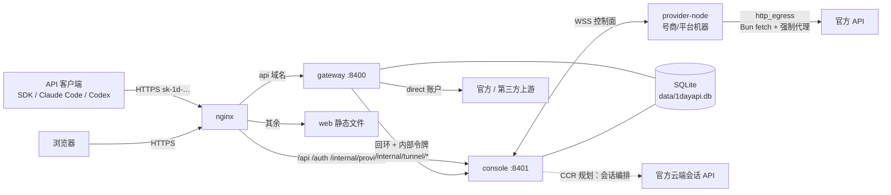
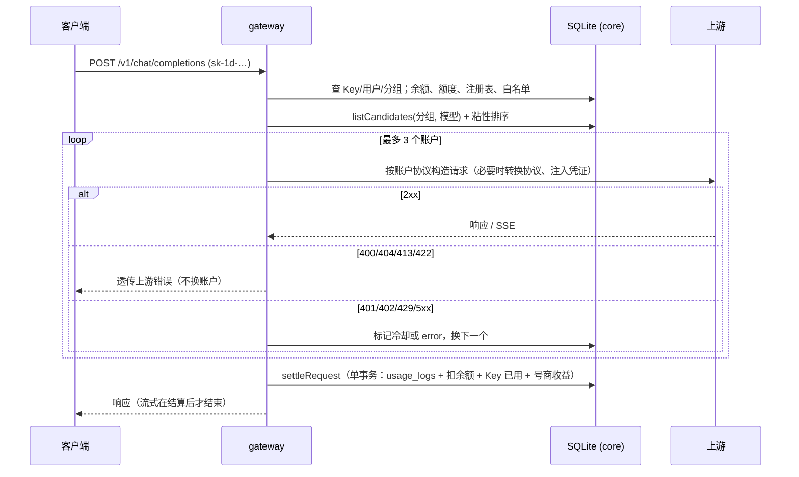
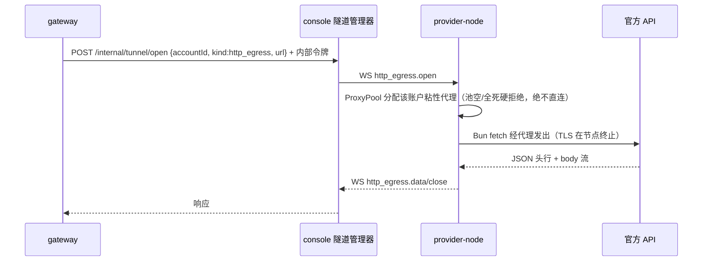

# 系统架构总览（v3）

> 入口文档：结构、组件职责、核心数据流与关键决策。契约见 [`v3-design.md`](./v3-design.md)，
> 下一阶段供给端方向见 [`ccr-supply.md`](./ccr-supply.md)，子系统细节见文末「延伸阅读」。以 2026-10-15 的 v3 代码为准。

## 1. 产品定位

1DayAPI 是 OpenRouter / sub2api 风格的多模型 AI API 中转平台：

- **一把 Key 调多家模型**：对外提供 OpenAI（Chat Completions / Responses）与 Anthropic（Messages）兼容协议，网关在两种协议间自动转换。
- **上游池**：上游可以是官方 API Key、第三方中转 API（任意 Base URL）、订阅账号 OAuth 令牌（直连路径），
  以及规划中的**云端会话供给**（CCR：订阅账号经官方云端会话能力执行，见 `ccr-supply.md`）；由管理员直接接入，或由号商提交后经管理员审核。
- **按量计费**：实扣 = 模型标准价 × 分组倍率，从余额扣；余额来自管理员发放的兑换码或调账。
- **号商分成**：号商账户产生的用量按 `标准价 × 分成比例` 记入其未结算收益，由管理员线下结算并记账。
- **不开放注册**：账户只能由管理员开通（发放登录密钥），没有推荐返利。

| 角色 | 登录密钥 | 做什么 |
|---|---|---|
| 管理员 | `1dk_admin_…` | 用户、分组、上游账户、定价、兑换码、用量、节点、结算、设置；也可给自己建 Key |
| 用户（consumer） | `1dk_consumer_…` | 自建多把 `sk-1d-…` API Key（各自分组 / 额度 / 过期），看用量，兑换充值 |
| 号商（provider） | `1dk_provider_…` | 绑定节点、上传订阅账号、提交上游 API、看收益与结算；不能调推理 |

## 2. 组件

| 组件 | 位置 | 职责 |
|---|---|---|
| core | `packages/core` | 打开共享 SQLite + 版本化迁移、加密主钥与内部令牌、模型注册表与计价、白名单、平台默认值、候选账户与冷却、结算事务 |
| catalog | `packages/catalog` | 内置 45 个模型与官方价目（注册表的种子数据） |
| gateway | `apps/gateway` :8400 | 推理入口：Key 鉴权 → 准入 → 选账户 → 协议转换 → 上游 / 节点隧道 → 流式 → 结算 |
| console | `apps/console` :8401 | 控制台 API（三角色）、会话登录、节点 WS 控制面、隧道管理器 |
| web | `apps/web` :8402 | 公开站点（首页、模型、价格、文档、校验工具，风格不变）+ `/console` 三角色控制台 |
| provider-node | `apps/provider-node` | 号商/平台机器上的守护进程（Bun 运行时）：本地控制台、WS 桥接、HTTP 出口（强制代理池）、账号操作出口（规划） |

gateway 与 console 不互相调用业务接口：两者通过 core 读写**同一个 SQLite 库**；唯一的进程间调用是网关经回环 HTTP 使用 console 的隧道管理器
（带内部令牌）。

## 3. 部署拓扑

- 生产环境 v3 已全部上线（见 `operations.md` 与 `deployment/`）。
- 首次以 v3 打开 v2 库会自动执行迁移 1（旧表改名 `legacy_v2_*` 保留）；migration 2 为节点管理表。

## 4. 核心数据流

### 4.1 推理请求

### 4.2 号商节点隧道（route=node 的账户，协议 v2）

### 4.3 节点绑定与上传

号商在控制台生成绑定码 → 节点 `bind` 换取节点密钥 → WS 连接上线 → 节点上传本机 CLI 的订阅 OAuth 令牌 →
平台写入 `accounts`（`type=oauth, route=node, review_status=pending`）→ 管理员审核通过（选分组、优先级、分成）后参与调度。
管理员还可：SSH 自动部署节点（`POST /api/admin/nodes/deploy`）、在服务器本机起节点（`/local`）、
推送节点代理池（`PUT /api/admin/nodes/:id/proxies`）。

### 4.4 订阅账号供给：云端会话 / worker（见 `ccr-supply.md`；worker 持久会话见 `worker-sessions.md`）

> 2026-10-17 现状：全部 99 个订阅账号为 `executor=ccr_worker`（节点上的真实 Claude Code 进程），云端会话 executor 保留但无账号在用。
> 非 CC 客户端请求 → worker；真 CC 形态请求 → 直连（`gateway.md` §2a）。

订阅账号经 sessionKey 非浏览器直连授权接入（经节点代理，令牌对加密入库、8h 刷新保活、validate 巡检）→ 每账号创建云端执行环境 →
客户请求经翻译层转为 code session 事件流 → 官方云端 worker 执行 → 事件流翻译回 Messages API 响应。
调度按订阅窗口水位过滤候选账户。

### 4.4 控制台登录

`POST /auth/login {key: 1dk_…}` → 校验哈希与账户状态 → 写 `user_sessions`、下发 `oneday_session` cookie →
前端按角色进入 `/console` 并显示对应菜单。

## 5. 关键设计决策

| 决策 | 理由 |
|---|---|
| 登录密钥与 API Key 分离 | 保持"无用户名密码"的密钥登录，同时让一个账户下有多把可独立限额 / 吊销的调用 Key |
| 共享 core + 单库 | 消除两份 DDL；网关直接解密凭证，明文不再经 HTTP 传递 |
| 不在注册表的模型直接拒绝 | 杜绝"未知模型 0 计费" |
| 后结算 + 允许透支 | 不做预扣，单请求可能把余额扣成负数，但不丢单；下一次请求在准入处拦下 |
| 4xx 透传、其余换账户 | 客户端参数错误换账户无意义；限流 / 鉴权 / 5xx 才故障转移 |
| 号商账户先审核 | 平台对上游质量与合规负责 |
| 调度状态在进程内 | 粘性会话、并发计数、OAuth 刷新锁都在网关内存，只支持单实例 |
| 节点出口强制代理（协议 v2） | 账户级粘性代理 + 池空硬拒绝，杜绝直连泄漏；TLS 在 Bun 节点终止，与官方客户端同族 |
| 订阅账号双轨供给（D7） | 直连路径保功能完整；CCR 云端会话路径换执行力与兼容性无忧，见 `ccr-supply.md` |
| 授权经节点代理直连（D8，2026-10-18 修订） | sessionKey 作 Bearer 调 `/v1/oauth/{org}/authorize` + PKCE，不需要浏览器；旧“必须真实浏览器”结论只适用于当时的 scope/请求组合 |

## 6. 成熟度

| 能力 | 状态 |
|---|---|
| 鉴权、Key、分组、白名单、额度 | 完成，e2e 覆盖 |
| 协议转换（文本 / 图片 / 工具 / 流式） | 完成，mock 上游 e2e 覆盖；真实上游待验证 |
| 计费、兑换码、调账、号商收益与结算 | 完成，e2e 覆盖 |
| 故障转移与冷却 | 完成，e2e 覆盖 429 / 400 / 停用 |
| 节点隧道（协议 v2 http_egress + 代理池） | 完成，本地+服务器 E2E 覆盖 |
| 节点管理平台（部署/代理池/绑定/容量） | 完成，服务器实测通过 |
| CC 形态分流器（真 CC → 直连，其余 → worker）与软/硬冷却 | 完成（2026-10-16），生产运行；`gateway.md` §2a/§3 |
| worker 路径：隔离（ccworker + scratch + 自检）、图片、system prompt 替换、每轮分块缓存命中、错误结果 502、session-limit 冷却 | 完成（2026-10-16～17），生产运行；`ccr-supply.md` §8.1 |
| worker 持久会话（进程池、回收与容量、按轮增量计费） | 阶段 1 完成（2026-10-17，`ccr_worker_persistent=1`）；阶段 2～4（原生工具 / thinking / document）规划中，`worker-sessions.md` |
| 一号一设备（直连改写 device_id / account_uuid，节点身份为真相源） | 完成（2026-10-17）；`claude-code-compat.md` §10 |
| 缓存计费口径（基线 700 / 写按输入价 / ForceCacheBilling） | 完成（2026-10-17）；`ccr-supply.md` §7.1、`gateway.md` §计费 |
| 节点优雅排空 + console 等待节点重连；代理判死连续 3 次 | 完成（2026-10-17）；`operations.md` §2、`onboarding.md` §6.1 |
| 客户端兼容性（CC 2.1.300 头集） | 完成（`claude-code-compat.md`），差异仅 accept-encoding zstd |
| OAuth 订阅账号 | Anthropic 基本可用（Bearer + oauth beta + 刷新）；ChatGPT 仅 `/v1/responses`，实验性 |
| 云端会话供给（CCR） | 规划中，契约 `ccr-supply.md`；授权接入管线待建 |
| 图片 / 视频生成 | 未做（501） |
| TEE 证明 | HMAC 桩，需请求头开启 |
| 前端控制台 | 三角色页面见 `web.md` |

## 延伸阅读

| 主题 | 文档 |
|---|---|
| 契约与决策 | `v3-design.md` |
| 表结构与迁移 | `data-model.md` |
| 网关细节 | `gateway.md` |
| 控制台接口 | `console-api.md` |
| 前端 | `web.md` |
| 错误码 | `errors.md` |
| 本地开发与测试 | `development.md` |
| 节点协议 / 节点实现 | `provider-protocol.md`、`provider-node.md` |
| 遗留问题 | `issues-and-decisions.md` |
